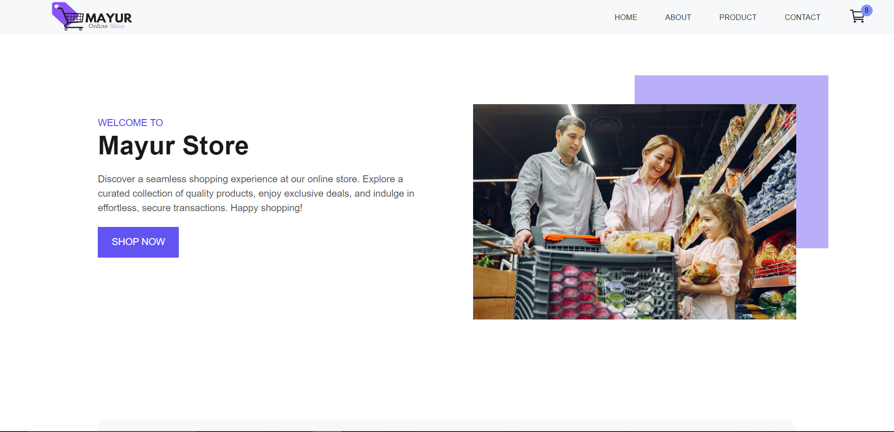

# 🛍️ Mayur E-commerce

A responsive **React e-commerce storefront**. Products load from a public REST API, and shoppers can browse, search, filter, sort, view product details and manage a shopping cart that is saved in the browser.



<!-- Live demo (add your deployed URL) -->
<!-- 🔗 **Live Demo:** https://your-demo-link.vercel.app -->

## ✨ Features

- **Product listing** with **grid and list views**
- **Search** by product name
- **Filters** by category, company, color and maximum price, plus a **Clear Filters** button
- **Sorting**: price (lowest / highest) and name (A-Z / Z-A)
- **Product details** page with image gallery, star rating, reviews count, brand, stock status and delivery / warranty info
- **Color picker and quantity selector** (quantity limited to available stock)
- **Shopping cart**: add, increase / decrease quantity, remove item, clear cart
- **Order summary** with subtotal, shipping fee and order total, formatted in Indian Rupees (₹)
- **Cart saved in `localStorage`**, so it survives page refresh
- **Contact form** powered by [Formspree](https://formspree.io/)
- Loading spinner (Material UI) and 404 error page
- Fully responsive layout with `styled-components`

## 🛠️ Tech Stack

| Technology | Usage |
| ---------- | ----- |
| React 18 | UI library |
| React Router DOM 6 | Routing |
| Context API + `useReducer` | Global state for products, filters and cart |
| Axios | API requests |
| styled-components | Styling and theming |
| Material UI | Loading spinner |
| React Icons | Icons |
| Formspree | Contact form backend |
| Prettier | Code formatting |

## 🌐 API

Product data comes from a free public API (no API key needed):

```
GET https://api.pujakaitem.com/api/products
```

## 📁 Project Structure

```
E-commerce/
├── public/
│   └── images/              # Logos, hero and product images
└── src/
    ├── Pages/               # Home, About, Products, SingleProduct, Cart, Contact, ErrorPage
    ├── components/          # Header, Nav, Footer, GridView, ListView, FilterSection, Sort, AddToCart, CartItem ...
    ├── Context/             # ProductContext, FilterContext, CartContext
    ├── reducer/             # productReducer, FilterReducer, Cart_Reducer
    ├── Helper/              # CurrencyFormate, Progress (loader)
    ├── styles/              # Reusable styled Button and Container
    ├── GlobalStyle.jsx
    ├── App.js               # Routes and theme
    └── index.js             # Providers setup
```

## 🧭 Routes

| Path | Page |
| ---- | ---- |
| `/` | Home |
| `/about` | About |
| `/products` | All products with filters and sorting |
| `/singleproduct/:id` | Product details |
| `/cart` | Shopping cart |
| `/contact` | Contact form |
| `*` | 404 page |

## 🚀 Getting Started

**Prerequisites:** [Node.js](https://nodejs.org/) 16 or higher and npm. No `.env` file is required.

```bash
# 1. Clone the repository
git clone https://github.com/mkkapadi12/E-commerce.git

# 2. Go to the project folder
cd E-commerce

# 3. Install dependencies
npm install

# 4. Start the development server
npm start
```

Open [http://localhost:3000](http://localhost:3000) in your browser.

## 📜 Available Scripts

| Command | Description |
| ------- | ----------- |
| `npm start` | Run the app in development mode |
| `npm run build` | Create an optimised production build |
| `npm test` | Run tests in watch mode |
| `npm run format` | Format code with Prettier |

## 🔮 Future Improvements

- [ ] User authentication (login / signup)
- [ ] Checkout and payment integration
- [ ] Wishlist and order history
- [ ] Pagination for product list
- [ ] Own backend API (Node.js + MongoDB)

## 👤 Author

**Mayur Kapadi**

- GitHub: [@mkkapadi12](https://github.com/mkkapadi12)
- Email: mayurkapadi12@gmail.com

---

⭐ If you like this project, consider giving it a star!
